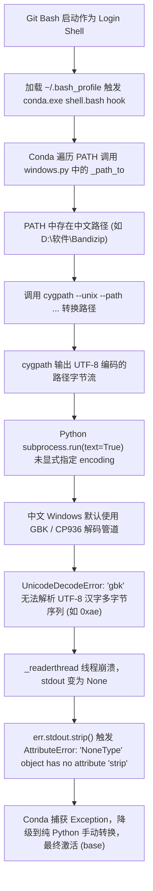

# Git Bash 启动报 Miniconda UnicodeDecodeError 与 cygpath 错误排查（附 Conda 初始化导致 Codex 丢失踩坑）

自从本人在电脑上装了 Miniconda 之后，每次启动 Git Bash 总是弹出一长串刺眼的红色 Python 报错堆栈：

```text
Exception in thread Thread-5 (_readerthread):
Traceback (most recent call last):
  File "D:\miniconda\Lib\threading.py", line 1082, in _bootstrap_inner
    self._context.run(self.run)
  File "D:\miniconda\Lib\threading.py", line 1024, in run
    self._target(*self._args, **self._kwargs)
  File "D:\miniconda\Lib\subprocess.py", line 1614, in _readerthread
    buffer.append(fh.read())
UnicodeDecodeError: 'gbk' codec can't decode byte 0xae in position 893: illegal multibyte sequence
Unexpected cygpath error, fallback to manual path conversion
  AttributeError: 'NoneType' object has no attribute 'strip'
(base)
```

最让人困惑的是：报错结束后，命令行提示符前却依然挂着 `(base)`，Conda 好像又勉强激活了。但只要重新开一个窗口，这串报错就会如期而至，强迫症根本无法容忍。

本人在网上搜索了这个问题，看到很多人建议在 `~/.bashrc` 加上 `export PYTHONIOENCODING=utf-8`。然而实测后发现：**根本没有任何效果，报错依旧**。

更富有戏剧性的是：在搞定这个 Miniconda 报错、让 Conda 正常接管 Git Bash 之后，因为 Conda 对终端 PATH 的接管与重组，**又引发了随后在修复 Codex 时，Windows 新加的 PATH 无法传进 Git Bash、导致命令找不到的连环大坑**！

本文将从 Git Bash 的启动执行流、Conda 路径转换源码、Windows ANSI 与 UTF-8 编码机制等多维度彻底拆解这个“幽灵报错”，并复盘由 Conda 初始化引发的后续 Codex PATH 丢失踩坑全过程。

---

## 1. 现象复现与无效尝试

### 现象特征
- **环境**：Windows 10/11 + Git Bash (MSYS2) + Miniconda / Anaconda (Python 3.10+)。
- **触发时机**：打开 Git Bash 终端瞬间。
- **核心报错**：
  1. `subprocess.py: UnicodeDecodeError: 'gbk' codec can't decode byte 0xae in position ...`
  2. `Unexpected cygpath error, fallback to manual path conversion`
  3. `AttributeError: 'NoneType' object has no attribute 'strip'`
- **表面现象**：报错结束后，提示符依然显示 `(base)`，基础 conda 命令表面上看起来还能跑。

### 为什么常规手段全部失效？

#### 误区 1：在 `~/.bashrc` 添加 `export PYTHONIOENCODING=utf-8`
按照网上的说法在 `~/.bashrc` 添加了这行，但依然报错。原因有二：
1. **Shell 执行生命周期错位**：Git Bash 默认以 Login Shell 方式启动，它最先读取的是 `~/.bash_profile`。而 `conda init` 插入的初始化代码恰恰位于 `~/.bash_profile` 的最开头！当 Conda 执行钩子时，`~/.bashrc` 根本还没被 `source`。
2. **变量作用范围受限**：`PYTHONIOENCODING` 仅仅控制 Python 自身的标准流（`sys.stdin`、`sys.stdout`、`sys.stderr`），并不会改变 Python 底层 `subprocess.run(text=True)` 或内置文件操作的默认字符集。

#### 误区 2：盲目执行 `conda init bash`
反复运行 `conda init bash` 只是重新生成了初始化钩子脚本，只要环境中的诱发根因没有消除，每次重新进入 Bash 依然必定触发异常。

---

## 2. 深度剖析：源码级别的根因追踪

为了搞清为什么会崩在 `subprocess.py`，我们深入 Miniconda 的源码定位问题：

### 第一步：定位报错位置
在 Miniconda 安装目录的 `conda/common/path/windows.py` 中，我们可以找到对应的代码片段：

```python
# miniconda/Lib/site-packages/conda/common/path/windows.py
def _path_to(paths, prefix=None, *, cygdrive=False, to_unix=True):
    ...
    bash = which("bash")
    cygpath = str(Path(bash).parent / "cygpath") if bash else "cygpath"
    joined = (
        str(paths)
        if isinstance(paths, (str, os.PathLike))
        else from_pathsep.join(map(str, paths))
    )

    converted: str | None = None
    try:
        # if present, use cygpath to convert paths since its more reliable
        converted = subprocess.run(
            [cygpath, cygpath_arg, "--path", joined],
            text=True,
            capture_output=True,
            check=True,
        ).stdout.strip()
    except FileNotFoundError:
        log.warning("cygpath is not available, fallback to manual path conversion")
    except subprocess.CalledProcessError as err:
        log.error(
            "Unexpected cygpath error, fallback to manual path conversion\n  %s: %s\n  stdout: %s\n  stderr: %s",
            err.__class__.__name__,
            err,
            err.stdout.strip(),
            err.stderr.strip(),
        )
    except Exception as err:
        log.error(
            "Unexpected cygpath error, fallback to manual path conversion\n  %s: %s",
            err.__class__.__name__,
            err,
        )
    ...
```

### 第二步：还原崩溃链条

这里隐藏着一个连锁性的致命冲突：



1. **诱因：Windows PATH 中的中文路径**
   在 PowerShell 中运行以下命令，即可揪出系统中的中文路径：
   ```powershell
   $env:PATH -split ';' | Where-Object { $_ -match '[\u4e00-\u9fa5]' }
   ```
   很多国产软件或开发工具喜欢把安装路径放到带有中文的目录下（例如 `D:\软件\Bandizip\`、`D:\微信web开发者工具\dll` 等），这些路径被写入了系统的 `PATH` 环境变量。

2. **工具链编码不一致**：
   - Git Bash 自带的 `cygpath.exe` 是典型的 POSIX 工具，其输出字符串采用标准 **UTF-8** 编码。
   - 当中文字符通过 `cygpath` 转换后输出时，是一串 UTF-8 字节。
   - 而运行在 Windows 下的 Conda 内部执行了 `subprocess.run(..., text=True, capture_output=True)`，**没有显式传 `encoding="utf-8"`**！
   - 在简体中文 Windows 下，Python 默认的 `locale.getencoding()` 是 **GBK (CP936)**。

3. **线程崩溃与 NoneType 连环车祸**：
   - Python 的 `_readerthread` 线程尝试用 GBK 编码去解码这串 UTF-8 数据，读到 UTF-8 汉字的多字节尾部（如 `0xae`）时，立刻抛出 `UnicodeDecodeError`。
   - 线程未捕获该异常，直接将堆栈打印到标准错误。
   - 随后子进程的 `stdout` 流未完整生成，变成 `None`。
   - Conda 源码中的错误处理逻辑尝试访问 `err.stdout.strip()`，导致二次崩溃抛出 `AttributeError: 'NoneType' object has no attribute 'strip'`。
   - 最终外层的 `except Exception:` 再次截获了这个错误，进入了兜底的手工字符串替换（`cygpath_fallback`），这就是为什么最后看起来还能勉强激活 `(base)` 的原因。

---

## 3. Miniconda 报错的终极解决方案

了解了根本机制后，我们就可以对症下药。推荐以下三种方案：

### 方案一：开启 Python 官方全局 UTF-8 模式（最推荐，一劳永逸）

从 Python 3.7 开始，官方引入了 [PEP 540 (Python UTF-8 Mode)](https://peps.python.org/pep-0540/)。只要环境变量中设置了 `PYTHONUTF8=1`，Python 会在全局范围内将文本读取、默认编码和子进程管道解码一律切换为 UTF-8，彻底告别中文 Windows 下各种离奇的 GBK 编解码 Bug。

在 PowerShell 中以当前用户身份运行以下命令即可完成全局设置：

```powershell
# 永久设置用户环境变量 PYTHONUTF8=1
[Environment]::SetEnvironmentVariable("PYTHONUTF8", "1", "User")
```

或者通过 Windows 图形界面设置：
1. 按下快捷键 `Win + S`，输入并打开 **“编辑系统环境变量”**。
2. 点击右下角 **“环境变量”**。
3. 在上方 **“用户变量”** 中点击 **“新建”**：
   - 变量名：`PYTHONUTF8`
   - 变量值：`1`
4. 一路点击 **“确定”** 保存退出。

> **效果**：不仅 Git Bash，你在 PowerShell、CMD、VS Code 内置终端运行任何 Python 脚本时，都能享受到原生 UTF-8 支持。

---

### 方案二：配置 Git Bash 专属的启动环境（局部见效）

如果你只想影响 Git Bash 环境，可以直接在 Git Bash 的用户配置文件中声明。

**关键避坑点**：必须写在 `~/.bash_profile` 的**最顶部**（在 `# >>> conda initialize >>>` 之前），并且文件必须保存为**不带 BOM 的 UTF-8 编码**！

#### 1. 编辑 `~/.bash_profile`
打开 `C:\Users\<你的用户名>\.bash_profile`，确保第一行为 `export PYTHONUTF8=1`：

```bash
export PYTHONUTF8=1

# >>> conda initialize >>>
# !! Contents within this block are managed by 'conda init' !!
if [ -f '/d/miniconda/Scripts/conda.exe' ]; then
    eval "$('/d/miniconda/Scripts/conda.exe' 'shell.bash' 'hook')"
fi
# <<< conda initialize <<<

source ~/.bashrc
```

#### 2. 编辑 `~/.bashrc`
在 `~/.bashrc` 顶部也加上该声明，以保证非登录子 shell（例如在终端里直接敲 `bash`）也生效：

```bash
export PYTHONUTF8=1
export PYTHONIOENCODING=utf-8
. /d/miniconda/etc/profile.d/conda.sh
```

> **注意**：切勿使用 Windows 自带记事本或 PowerShell 5.1 默认的 `Set-Content -Encoding utf8`，否则会自动插入 `\xEF\xBB\xBF` (BOM 头)，导致 Bash 启动报错 `bash: $'\357\273\277export': command not found`。推荐使用 VS Code 打开保存，或在 VS Code 状态栏确认编码为 `UTF-8`（无 BOM）。

---

### 方案三：清理并规范 Windows PATH 中的中文路径（治本之道）

如果你希望彻底避免此类问题，可以把环境变量中含有中文的路径修正：

1. 在 PowerShell 中列出所有含有中文的 PATH 路径：
   ```powershell
   $env:PATH -split ';' | Where-Object { $_ -match '[\u4e00-\u9fa5]' }
   ```
2. 检查这些软件是否可以重新安装到纯英文路径（如 `D:\Softwares\...`、`D:\DevTools\...`）。
3. 避免将开发环境、命令行工具或编译器的目录放置在包含中文、空格或特殊符号的文件夹内。

---

## 4. 连锁反应：解决报错后引发的 Codex 命令丢失案

通过上述方案彻底解决了 `UnicodeDecodeError` 和 `cygpath` 报错后，Git Bash 启动终于变得干干净净，没有半点红字。

**但万万没想到，前面为了让 Conda 正常工作而在 `~/.bash_profile` 和 `~/.bashrc` 中配置的 Conda 初始化逻辑，马上给我引出了一个新的连环坑！**

### 案发现场：修复 Codex 后加入 PATH，Git Bash 却报 command not found
没过多久，我本地日常使用的代码助手 **Codex**（OpenAI Codex CLI）某些文件突然坏了，导致命令无法运行。于是我对 Codex 进行了重新修复与文件补全，并按照惯例，将官方 Codex 的安装目录添加到了 Windows 的用户环境变量 `PATH` 中。

在 Windows 原生的 CMD 和 PowerShell 中随手敲了一下测试，`codex` 都能正常识别并执行。

然而，当我切回到刚刚调好 Conda 环境的 **Git Bash** 中准备使用时，一敲 `codex`，终端却直接无情回敬：
```bash
$ codex
bash: codex: command not found
```
明明 Windows 用户环境变量里已经加进去了，为什么 Git Bash 完全找不到？

### 排查线索：消失在 PATH 中的 Codex
为了查明原因，我在 Git Bash 终端中打印了当前 Shell 看到的全局环境变量：
```bash
$ echo $PATH
```
仔细搜寻了一遍输出结果，我赫然发现：**打印出来的 `$PATH` 里压根就没有 OpenAI/Codex 那段！**

Windows 用户 PATH 的新增项，根本没有传进 Git Bash。

### 深层根因：Git Bash / Conda 初始化没有包含新加的 PATH
为什么 Windows 用户变量新加的 PATH 无法传进 Git Bash？

**根因正是前面解决 Miniconda 报错并启用 Conda 后，Git Bash 的环境生命周期被 Conda 深度接管了！**

1. **Conda 初始化钩子接管环境**：虽然我们把官方 Codex 目录加进了 Windows 用户 PATH，但 Git Bash 由 Conda 初始化（`~/.bash_profile` 和 `~/.bashrc` 都有 Conda 逻辑）；
2. **PATH 被重组成它自己的形式**：Git Bash 启动时执行 Conda 钩子脚本（`conda shell.bash hook` 和 `conda.sh`），Conda 会介入并按照它自己环境的优先级，对全局 `$PATH` 进行清洗、重排序与重组；
3. **环境继承滞后与穿透失效**：如果在修改 Windows PATH 时，Git Bash 或其宿主进程（如 VS Code 终端、Windows Terminal 预热进程）未彻底重启，Git Bash 继承的本身就是旧环境快照；再加上 Conda 初始化重组了 PATH，导致 Windows 用户 PATH 的新增项根本没有传进 Git Bash。

### 对症解决：显式桥接与环境刷新

#### 方案 A：在 `~/.bashrc` 中显式 Bridge 导出 PATH（最稳妥推荐）
既然 Git Bash 由 Conda 初始化重构 PATH，最保险的做法是在 Git Bash 自己的配置文件中，将该工具的 Linux 风格路径显式追加进 `PATH`：

打开 `C:\Users\<你的用户名>\.bashrc`，在末尾追加：
```bash
# 显式将官方 Codex 路径桥接进 Git Bash PATH（请根据实际安装路径替换）
export PATH="$PATH:/c/Users/<你的用户名>/AppData/Local/Programs/@openai/codex"
```
保存后，在 Git Bash 中重新载入：
```bash
source ~/.bashrc
```
此时再运行：
```bash
which codex
```
终端便能精准定位到 `codex`，彻底不受 Conda 重组与 Windows 环境变量传递滞后的影响！

#### 方案 B：彻底退出所有终端宿主以重新加载注册表
如果你不想手动在 `~/.bashrc` 写死路径：
1. 退出所有正在运行的 Git Bash 终端；
2. **彻底关闭 VS Code 或终端管理器的所有后台常驻进程**；
3. 重新冷启动 Git Bash，此时 MSYS2 才会真正重新读取 Windows 注册表中的最新 User PATH 并传递给 Conda 处理。

---

## 5. 终极验证：干净利落的终极状态

在先后解决了 Miniconda cygpath 编码冲突以及 Conda 初始化重组导致的 Codex PATH 丢失后，重新打开 Git Bash：

1. 终端秒级干净启动，过去的红字 `UnicodeDecodeError` 彻底绝迹；
2. Conda 基础环境正常加载；
3. 切换虚拟环境丝滑顺畅；
4. 修复后的 `codex` 命令顺利识别并启动！

实测运行全过程：

```bash
(base)
catyuan@Legion-Y9000P UCRT64 /d/学习/blogsite (main)
$ conda activate ml
(ml)
catyuan@Legion-Y9000P UCRT64 /d/学习/blogsite (main)
$ python --version
Python 3.11.17
(ml)
catyuan@Legion-Y9000P UCRT64 /d/学习/blogsite (main)
$ codex
Session ID: 01a1738e-7241-7593-8a69-80956d2c911e
```

整个终端秒级清爽启动，`(ml)` 环境与 Python 3.11.17 激活自如，`codex` 命令顺利输出 Session ID 并正常进入交互！

---

## 6. 总结与避坑速查表

| 常见疑难场景 | 核心诱因 / 为什么失效 | 正确做法 |
| :--- | :--- | :--- |
| **Git Bash 启动报 `UnicodeDecodeError: 'gbk'` 与 `cygpath` AttributeError** | Windows PATH 含有中文路径，Conda `windows.py` 未指定 UTF-8 管道解码 | 设置系统/用户环境变量 `PYTHONUTF8=1` 开启 PEP 540 全局模式 |
| **在 `~/.bashrc` 写 `export PYTHONIOENCODING=utf-8` 无法消除报错** | Git Bash 先读 `~/.bash_profile`，且该变量不影响 `subprocess.run` 底层解码 | 设置用户环境变量 `PYTHONUTF8=1` |
| **编辑 `~/.bash_profile` 后报 `$'\357\273\277export': command not found`** | Windows 记事本等工具保存时自动携带了 UTF-8 BOM 头 | 使用 VS Code 保存为 UTF-8 无 BOM 格式 |
| **解决 Conda 报错后，Windows PATH 加了新工具（如 Codex），Git Bash 却报 `command not found`** | Git Bash 由 Conda 初始化（`~/.bash_profile` 和 `~/.bashrc` 都有 Conda 逻辑），PATH 被重组成它自己的形式，Windows 用户 PATH 的新增项未传进 Git Bash | 在 `~/.bashrc` 显式 `export PATH="$PATH:/c/..."` 桥接，或彻底重启所有终端宿主进程 |

Windows 上的 POSIX 模拟环境（Git Bash/MSYS2）与 Windows 宿主机原生环境变量交互时，**字符集编码差异**与**环境初始化对 PATH 的重构接管**是最隐蔽的两个深坑。理清了 Conda 的初始化机制与 `PYTHONUTF8=1`，往后遇到类似环境“幽灵”问题，就能一眼看穿本质、轻松化解。
